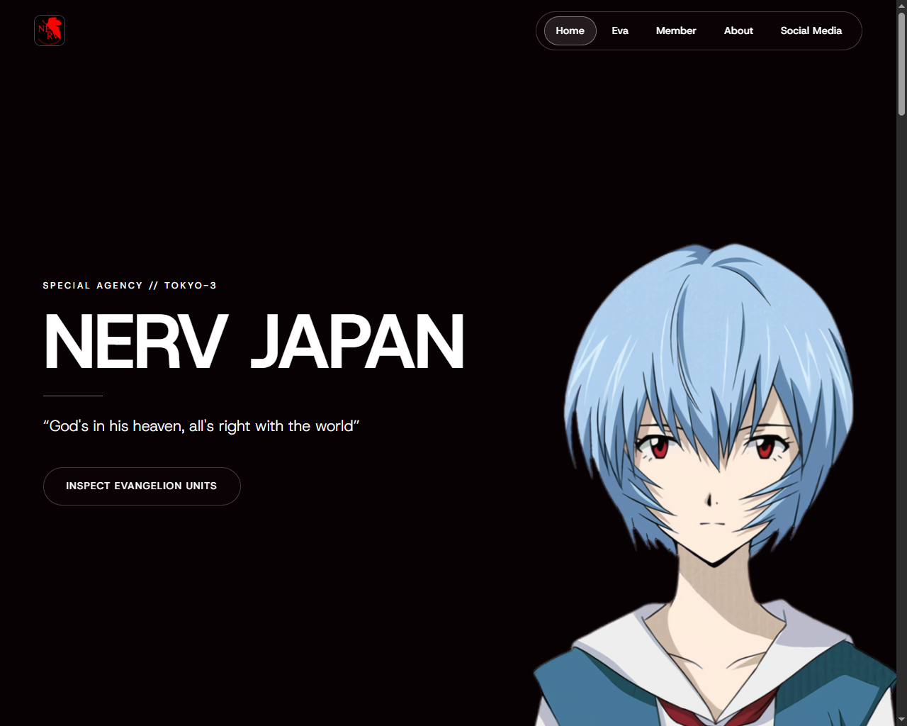
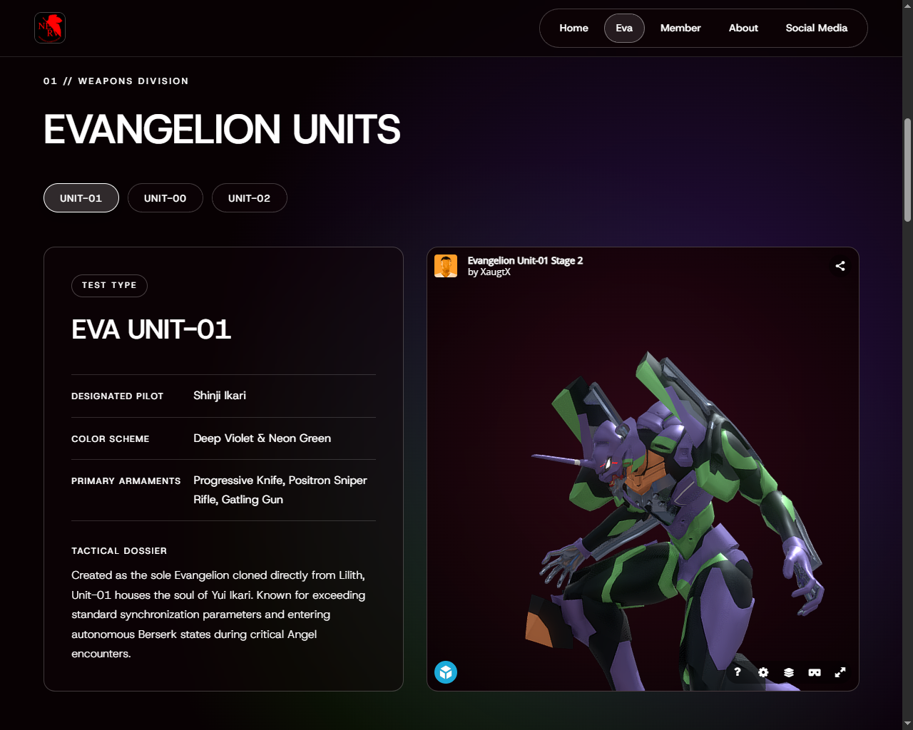
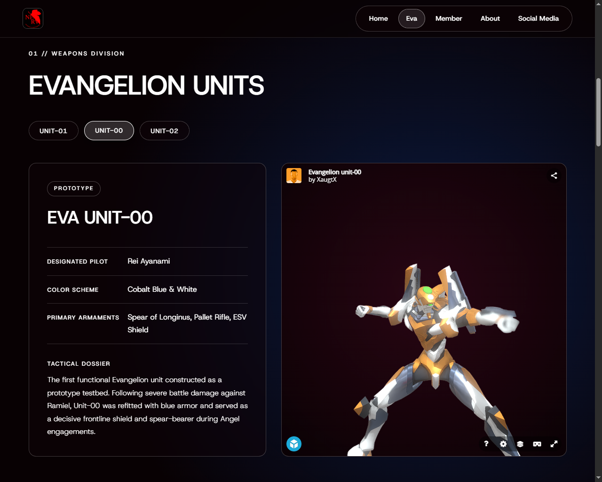
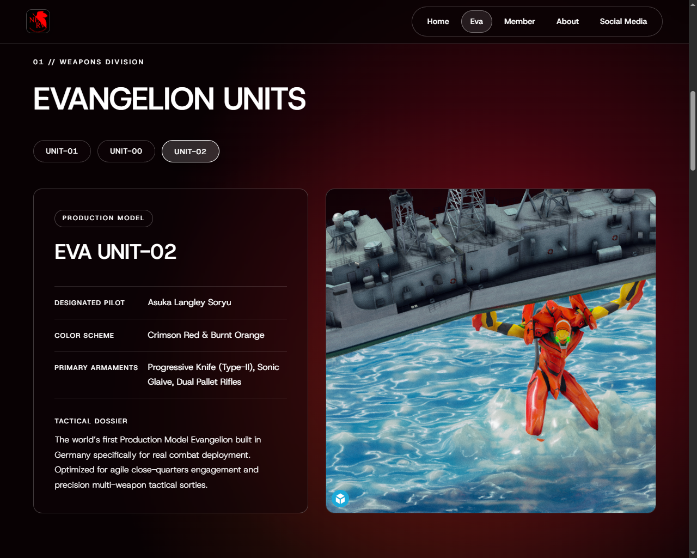
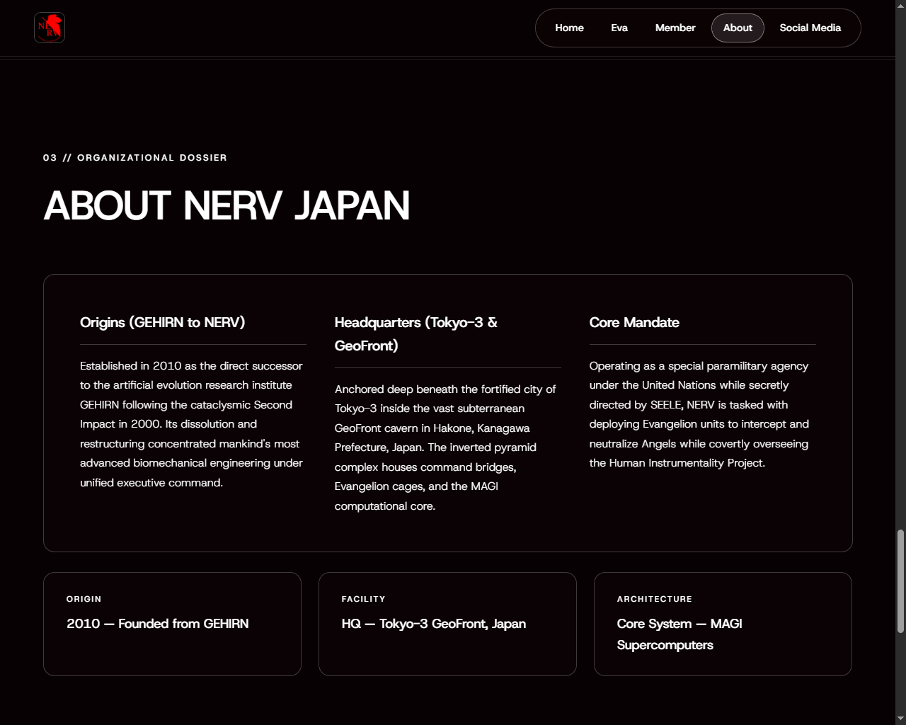
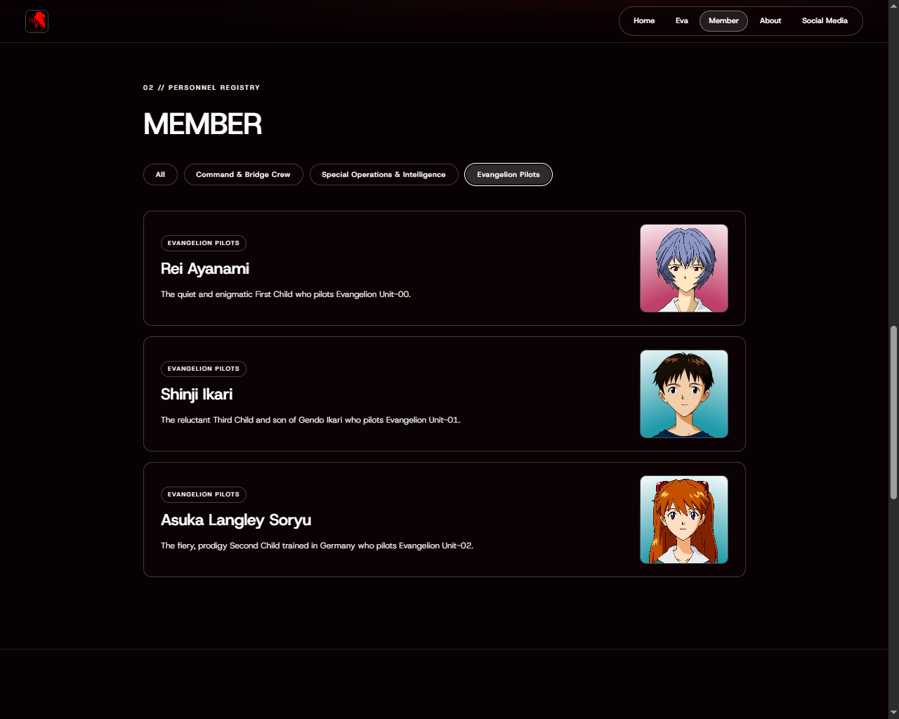
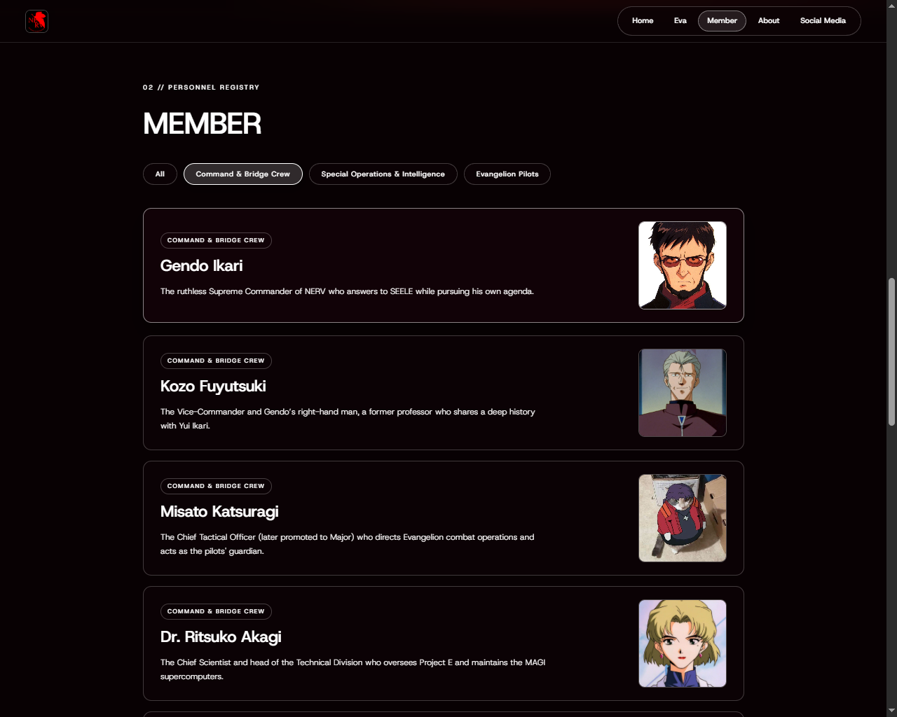

# NERV JAPAN — Special Agency // Tokyo-3

> *"God's in his heaven, all's right with the world."*

A dark-themed, fan-made tribute website inspired by **Neon Genesis Evangelion**, showcasing the **NERV Japan** headquarters, Evangelion Units dossier, agency lore, and personnel directory.

---

## ✨ Features

- **Hero Section:** Bold Tokyo-3 Special Agency header featuring Rei Ayanami and clean minimal navigation (`Home`, `Eva`, `Member`, `About`, `Social Media`).
- **Evangelion Units (`02 // WEAPONS DIVISION`):** Interactive unit switcher for:
  - **EVA UNIT-01** *(Test Type — Shinji Ikari)*
  - **EVA UNIT-00** *(Prototype — Rei Ayanami)*
  - **EVA UNIT-02** *(Production Model — Asuka Langley Soryu)*
  - Includes designated pilot, color scheme, primary armaments, and tactical dossier.
- **About NERV Japan (`03 // COMMAND & INTEL DOSSIER`):** Detailed cards covering **Origins (GEHIRN to NERV)**, **Headquarters (Tokyo-3 & GeoFront)**, **Core Mandate**, and **MAGI Supercomputers**.
- **Member Directory:** Filterable personnel cards featuring **Gendo Ikari**, **Kozo Fuyutsuki**, **Misato Katsuragi**, **Dr. Ritsuko Akagi**, **Ryoji Kaji**, **Maya Ibuki**, **Makoto Hyuga**, **Shigeru Aoba**, **Rei Ayanami**, **Shinji Ikari**, and **Asuka Langley Soryu**.

---

## 📸 Screenshots

### Home / Hero


### Evangelion Units
| EVA Unit-01 | EVA Unit-00 | EVA Unit-02 |
| :---: | :---: | :---: |
|  |  |  |

### About NERV Japan


### Member Directory
| Evangelion Pilots | Command & Technical Staff |
| :---: | :---: |
|  |  |

---

## 🛠️ Built With

- **HTML5** — Semantic structure and layout (`index.html`)
- **CSS3** — Custom dark-mode styling, crimson accents, and responsive grid/card layouts (`style.css`)
- **JavaScript** — Interactive unit tabs and member category filtering (`script.js`)

---

## 🚀 Getting Started

1. Clone this repository:
   ```bash
   git clone https://github.com/manyagami/nerv-evangelion-profile-web.git
   ```
2. Navigate into the project folder:
   ```bash
   cd nerv-evangelion-profile-web
   ```
3. Open `index.html` directly in your browser (or launch with Live Server).

---

## 🎖️ Credits

- **Design & Development:** [manyagami](https://github.com/manyagami)
- **Universe, Characters & Lore:** *Neon Genesis Evangelion* created by **Hideaki Anno** / **Gainax** / **Studio Khara**.
- This is a non-commercial fan project created for educational and portfolio purposes. All Evangelion trademarks, character artwork, and references belong to their respective owners.

---

## 🔗 Connect With Me

- **GitHub:** [@manyagami](https://github.com/manyagami)
- **Instagram:** [@mandarwishhhh](https://www.instagram.com/mandarwishhhh)
- **TikTok:** [@surrenderbythem](https://www.tiktok.com/@surrenderbythem)
- **Email:** [mandarwish017@gmail.com](mailto:mandarwish017@gmail.com)
